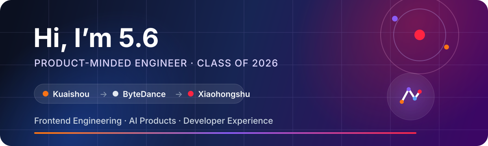

  

  
  
  

## Hi, I'm 5.6 👋

我将在 **2026 年毕业**，目前在 **小红书** 工作，此前曾在 **快手**、**字节跳动** 实习。

现在主要是 **前端工程师 / AI 全栈工程师 / PE 工程师**，持续在真实业务中打磨产品体验、工程质量与开发效率。

我喜欢把复杂问题拆成清晰、可靠、好用的产品，也在探索 AI 如何真正进入研发工作流，而不只是停留在 Demo。

## Journey

| Stage | Experience | What I care about |
| :--- | :--- | :--- |
| **Now** |  **小红书 · Work** | 产品体验、工程质量、规模化协作 |
| **Previously** |  **字节跳动 · Internship** | 前端工程、复杂业务交付 |
| **Previously** |  **快手 · Internship** | 业务实践、快速学习与迭代 |
| **Graduating in 2026** | 🎓 **Graduate** | 保持好奇，持续构建 |

## What I build

- **Frontend & Cross-platform** — TypeScript、React、Vue、React Native、Next.js
- **AI-native Products** — LLM / Image 工作流、Agent、Codex Skills、研发自动化
- **Full-stack Prototypes** — Node.js、Python，以及从想法到上线的完整闭环
- **Developer Experience** — 把重复劳动沉淀成工具，让团队更快、更稳地交付

  
  
  
  
  
  
  

## GitHub

  
  

---

  <i>Build useful things. Make complex things feel simple.</i>

